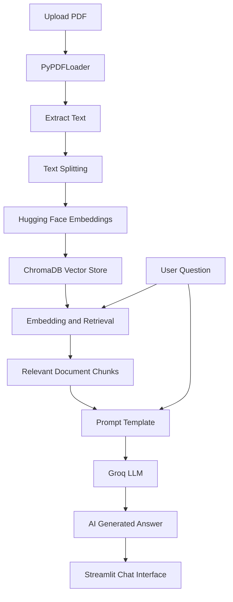

# 📚 PDF-Based RAG – Retrieval-Augmented Generation Application

An AI-powered PDF Question Answering Application built using **Python, LangChain, Hugging Face, ChromaDB, Groq, and Streamlit**.

Upload a PDF document, ask questions about its content, and get context-aware answers generated using a Large Language Model (LLM).

## 🚀 Features

- 📄 **PDF Upload:** Upload PDF documents directly through the Streamlit interface.
- 📝 **Document Loading:** Extract text from PDF files using PyPDFLoader.
- ✂️ **Text Splitting:** Divide documents into smaller chunks using RecursiveCharacterTextSplitter.
- 🧠 **Text Embeddings:** Generate vector embeddings using Hugging Face's `all-MiniLM-L6-v2`.
- 🗄️ **Vector Database:** Store and retrieve document embeddings using ChromaDB.
- 🔍 **Semantic Search:** Retrieve relevant document chunks based on user queries.
- 🤖 **AI-Powered Answers:** Generate contextual responses using Groq LLM.
- 💬 **Interactive Chat:** Ask multiple questions about your uploaded PDF through a Streamlit interface.
- 📖 **Source Documents:** View retrieved document chunks along with their page numbers.

## 🛠️ Tech Stack

| Technology | Purpose |
|---|---|
| Python | Core programming language |
| LangChain | RAG pipeline orchestration |
| PyPDFLoader | PDF text extraction |
| RecursiveCharacterTextSplitter | Document chunking |
| Hugging Face | Text embedding generation |
| all-MiniLM-L6-v2 | Embedding model |
| ChromaDB | Vector database |
| Groq | LLM inference |
| GPT-OSS-20B | Language model |
| Streamlit | Web application interface |

## 🏗️ RAG Architecture

The application follows a Retrieval-Augmented Generation workflow.



## ⚙️ How It Works

### 1. Document Processing

- The user uploads a PDF document.
- PyPDFLoader extracts text from the document.
- RecursiveCharacterTextSplitter divides the extracted text into manageable chunks.
- Each chunk is converted into a vector embedding using Hugging Face.

### 2. Vector Storage

- Generated embeddings are stored in ChromaDB.
- ChromaDB enables semantic similarity search to identify relevant document chunks.

### 3. Question Answering

- The user submits a question through the Streamlit chat interface.
- The retriever searches ChromaDB for relevant document chunks.
- Retrieved content is passed to a LangChain prompt template.
- Groq LLM generates an answer using the supplied document context.
- The generated response is displayed in the chat interface.

## 📂 Project Structure

```text
PDF-Based-RAG/
│
├── app.py                  # Streamlit application
├── create_database.py      # PDF processing and retriever creation
├── requirements.txt        # Python dependencies
├── .env.example            # Environment variable template
├── .gitignore              # Git ignored files
└── README.md               # Project documentation
```

## 💻 Installation and Setup

### Prerequisites

- Python 3.10+
- Git
- Groq API Key

### 1. Clone the Repository

```bash
git clone https://github.com/Prathik-09/PDF-based-RAG-Retrieval-Augmented-Generation-Application.git
```

### 2. Navigate to the Project Directory

```bash
cd PDF-based-RAG-Retrieval-Augmented-Generation-Application
```

### 3. Create a Virtual Environment

```bash
python -m venv .venv
```

Activate the environment:

**Windows:**

```powershell
.venv\Scripts\activate
```

**Linux / macOS:**

```bash
source .venv/bin/activate
```

### 4. Install Dependencies

```bash
pip install -r requirements.txt
```

### 5. Configure Environment Variables

Create a `.env` file in the project root directory.

Add your Groq API key:

```env
GROQ_API_KEY=your_groq_api_key_here
```

Get your API key from [Groq Console](https://console.groq.com/keys).

**Note:** Never commit your `.env` file or expose your API key on GitHub.

### 6. Run the Application

```bash
streamlit run app.py
```

The application will open in your browser.

## 📸 Application Workflow

1. Open the Streamlit application.
2. Upload a PDF document.
3. Click **Process PDF**.
4. Wait for document processing and embedding generation.
5. Ask questions about the uploaded document.
6. View AI-generated answers and retrieved source passages.

## 🎯 Learning Outcomes

Through this project, I explored and implemented:

- Retrieval-Augmented Generation (RAG).
- Document loading and text preprocessing.
- Text chunking and chunk overlap.
- Vector embeddings and semantic search.
- Vector databases and similarity retrieval.
- Connecting LLMs with external knowledge.
- Prompt engineering and context-based generation.
- Building an end-to-end Generative AI application.

## 🔮 Future Improvements

- Support multiple PDF uploads.
- Add conversation memory.
- Improve retrieval using MMR and hybrid search.
- Display source citations in generated answers.
- Add support for scanned PDFs using OCR.
- Improve document processing performance.
- Deploy the application online.

## 👨‍💻 Author

**Prathik**

Aspiring Software Developer | Exploring Generative AI, RAG, Python, and Full-Stack Development.

- GitHub: [@Prathik-09](https://github.com/Prathik-09)
- LinkedIn: [Connect with me](https://www.linkedin.com/)

---

⭐ If you find this project interesting, consider giving it a star!

**Built with curiosity, code, and a passion for learning Generative AI.** 🚀
